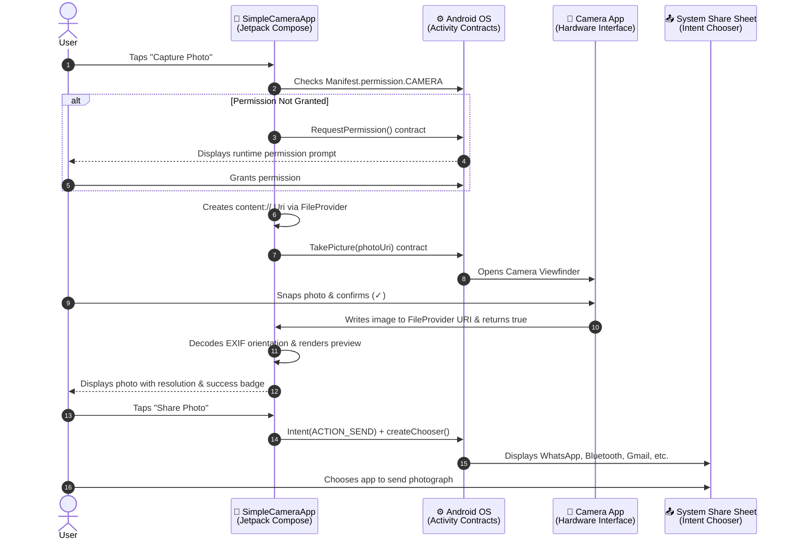

<div align="center">

# 📷 Simple Camera Application

**A modern Android application demonstrating Camera access, runtime permissions, photo capture via FileProvider, and Android System Sharing interface using Kotlin and Jetpack Compose.**

[](https://kotlinlang.org)
[](https://developer.android.com/jetpack/compose)
[](https://developer.android.com/studio)
[-34D399?style=for-the-badge&logo=android&logoColor=white)](https://www.android.com)

</div>

---

## 📖 Overview

This repository contains the completed project for the **Mobile Application Development** module assignment. The objective of this project is to build a camera and sharing application utilizing modern Android architecture and Jetpack Compose.

### Required Assignment Features:
1. **Open the device camera**: Launch the default device camera app via Android's camera intent contracts.
2. **Capture a photograph**: Take full-resolution photos and store them securely in the application cache.
3. **Display the captured photo**: Render the photograph within a custom Material 3 photo viewport with automatic EXIF orientation correction.
4. **Share Button**: An animated, tactile share action button enabled dynamically once a photo is captured.
5. **Android System Sharing Interface**: Trigger the native Android share sheet (`Intent.createChooser`), enabling users to share photos across any available app (e.g., Bluetooth, WhatsApp, Gmail, Telegram, Quick Share).

---

## 🧭 Architecture & Intent Flow



---

## ✨ Features & Highlights

- 📸 **Seamless Camera Access**: Leverages `ActivityResultContracts.TakePicture()` integrated cleanly with modern Jetpack Compose.
- 🔐 **Runtime Permissions**: Robust permission life-cycle checks (`Manifest.permission.CAMERA`) with state banners and toast alerts.
- 📁 **Secure FileProvider Integration**: Uses Android's `FileProvider` to generate compliant `content://` URIs, preventing `FileUriExposedException` on Android 7.0+ (API 24+).
- 🔄 **EXIF Orientation Correction**: Automatically parses image rotation metadata (`ExifInterface`) so captured photos display in the correct upright orientation regardless of hardware sensor position.
- 📤 **Native System Share Sheet**: Launches `Intent.createChooser()` with `FLAG_GRANT_READ_URI_PERMISSION`, providing one-tap sharing across WhatsApp, Bluetooth, Nearby Share, Messages, and Drive.
- 🎨 **Material Design 3 & Tactile Physics**: Styled with custom spring-damping animations, sleek gradients, frosted-glass borders, and reactive button elevation.

---

## 🧠 Key Technical Concepts Explained

### 1. Camera Permissions (Manifest & Runtime)

In modern Android, camera access requires both compile-time declaration in `AndroidManifest.xml` and user confirmation at runtime:

```xml
<!-- AndroidManifest.xml -->
<uses-permission android:name="android.permission.CAMERA" />
<uses-feature android:name="android.hardware.camera" android:required="false" />
```

```kotlin
// In Compose UI:
val permissionLauncher = rememberLauncherForActivityResult(
    contract = ActivityResultContracts.RequestPermission()
) { isGranted ->
    hasCameraPermission = isGranted
    if (isGranted) {
        Toast.makeText(context, "Permission granted! ✅", Toast.LENGTH_SHORT).show()
    }
}
```

### 2. Camera Access via FileProvider

Direct `file://` URIs are restricted across apps. We configure `androidx.core.content.FileProvider` in `AndroidManifest.xml` and `res/xml/file_paths.xml` to generate secure `content://` URIs:

```kotlin
// Creating a secure content:// URI
fun createImageFileUri(context: Context): Uri {
    val photosDir = File(context.cacheDir, "camera_photos").apply { mkdirs() }
    val photoFile = File(photosDir, "IMG_${System.currentTimeMillis()}.jpg")
    val authority = "${context.packageName}.fileprovider"
    return FileProvider.getUriForFile(context, authority, photoFile)
}
```

### 3. Photo Capture Contract

```kotlin
val takePictureLauncher = rememberLauncherForActivityResult(
    contract = ActivityResultContracts.TakePicture()
) { success ->
    if (success && pendingCameraUri != null) {
        photoBitmap = CameraUtils.loadRotatedBitmap(context, pendingCameraUri)
    }
}
```

### 4. Android System Sharing Interface

Clicking the Share button constructs an implicit `Intent(Intent.ACTION_SEND)` wrapped with `Intent.createChooser()`:

```kotlin
fun sharePhoto(context: Context, photoUri: Uri) {
    val shareIntent = Intent(Intent.ACTION_SEND).apply {
        type = "image/jpeg"
        putExtra(Intent.EXTRA_STREAM, photoUri)
        putExtra(Intent.EXTRA_SUBJECT, "Photo from Simple Camera App")
        putExtra(Intent.EXTRA_TEXT, "Captured using Simple Camera Application 📸")
        addFlags(Intent.FLAG_GRANT_READ_URI_PERMISSION)
    }
    val chooser = Intent.createChooser(shareIntent, "Share Photo via")
    context.startActivity(chooser)
}
```

---

## 📂 Project Structure

```text
simple-camera-app/
├── app/
│   ├── src/
│   │   └── main/
│   │       ├── java/com/example/simplecamera/
│   │       │   ├── MainActivity.kt               # Main screen with permission & capture orchestration
│   │       │   ├── components/
│   │       │   │   ├── AnimatedActionButton.kt   # Spring-physics tactile action buttons
│   │       │   │   ├── ConceptBadge.kt           # Course concept pill chips
│   │       │   │   └── PhotoPreviewCard.kt       # Card container with photo preview & empty state
│   │       │   ├── ui/theme/
│   │       │   │   ├── Color.kt                  # Material 3 colors & brand tokens
│   │       │   │   ├── Theme.kt                  # Dynamic color theme configuration
│   │       │   │   └── Type.kt                   # Typography scale
│   │       │   └── utils/
│   │       │       └── CameraUtils.kt            # FileProvider, EXIF rotation & Sharing helpers
│   │       ├── res/
│   │       │   ├── values/                       # strings.xml, colors.xml, themes.xml
│   │       │   ├── xml/
│   │       │   │   └── file_paths.xml            # FileProvider secure directory permissions
│   │       │   └── mipmap/                       # App launcher icons
│   │       └── AndroidManifest.xml               # Permissions, FileProvider & Activity declarations
│   └── build.gradle.kts                          # App-level build configurations & dependencies
├── gradle/
│   ├── libs.versions.toml                        # Version catalog (Compose BOM, Kotlin, AGP)
│   └── wrapper/                                  # Gradle 9.6.0 binary wrapper
├── settings.gradle.kts
└── README.md
```

---

## 🚀 Getting Started

### Prerequisites
- **Android Studio** (Ladybug 2024.2+ recommended)
- **JDK 17 or 21**
- **Android SDK** (Min API: 24, Target/Compile API: 35+)
- Physical Android device (recommended for camera testing) or Android Emulator with webcam emulation enabled.

### Installation & Run Instructions

1. **Clone the repository:**
   ```bash
   git clone https://github.com/Rajapakshaminindu/simple-camera-app.git
   ```

2. **Open the project in Android Studio:**
   - Launch Android Studio.
   - Click **Open** and select the cloned `simple-camera-app` directory.
   - Allow Gradle to sync dependencies automatically.

3. **Deploy & Test:**
   - Connect your physical Android phone (enable USB Debugging) or start an Android Emulator.
   - Click **Run ▶** (or press `Shift + F10`).
   - Grant camera permissions when prompted.
   - Tap **Capture Photo** to take a picture.
   - Tap **Share Photo** to open the system share sheet and send your photograph via Bluetooth, WhatsApp, etc.!

---

## 🎯 Learning Outcomes Satisfied

- [x] Implemented explicit and runtime camera permission validation.
- [x] Configured secure file sharing boundaries with `androidx.core.content.FileProvider`.
- [x] Invoked external camera applications using Android Activity Result contracts.
- [x] Corrected raw EXIF orientation data for accurate Jetpack Compose rendering.
- [x] Implemented the Android System Sharing interface (`Intent.ACTION_SEND` and `Intent.createChooser()`).

---

## 👤 Author

**Minindu Rajapaksha**
- GitHub: [@Rajapakshaminindu](https://github.com/Rajapakshaminindu)
- Repository: [simple-camera-app](https://github.com/Rajapakshaminindu/simple-camera-app)

---

<div align="center">

*Developed for the Mobile Application Development Module*

</div>
